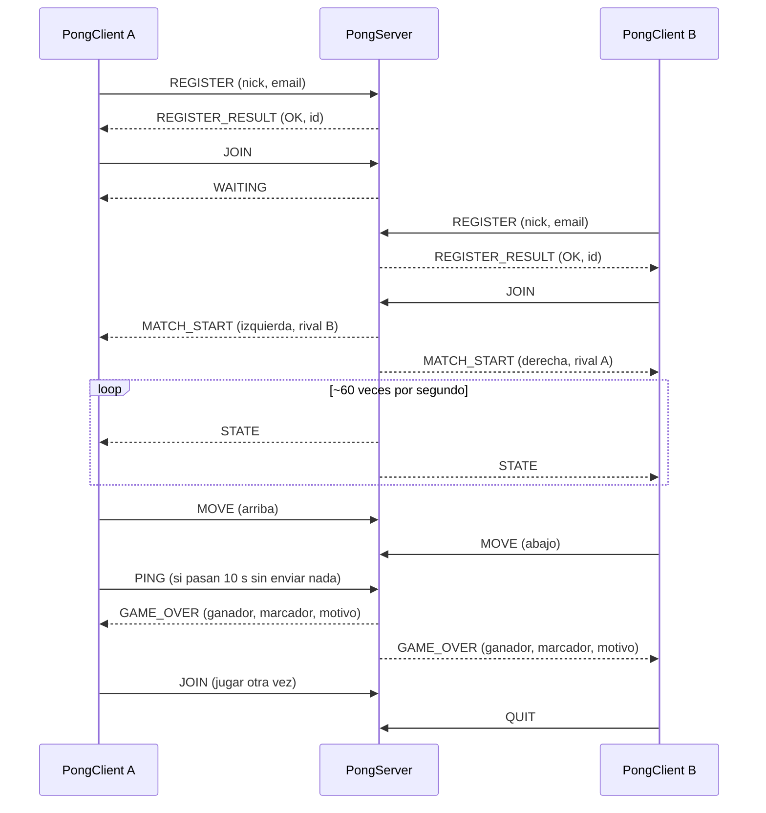
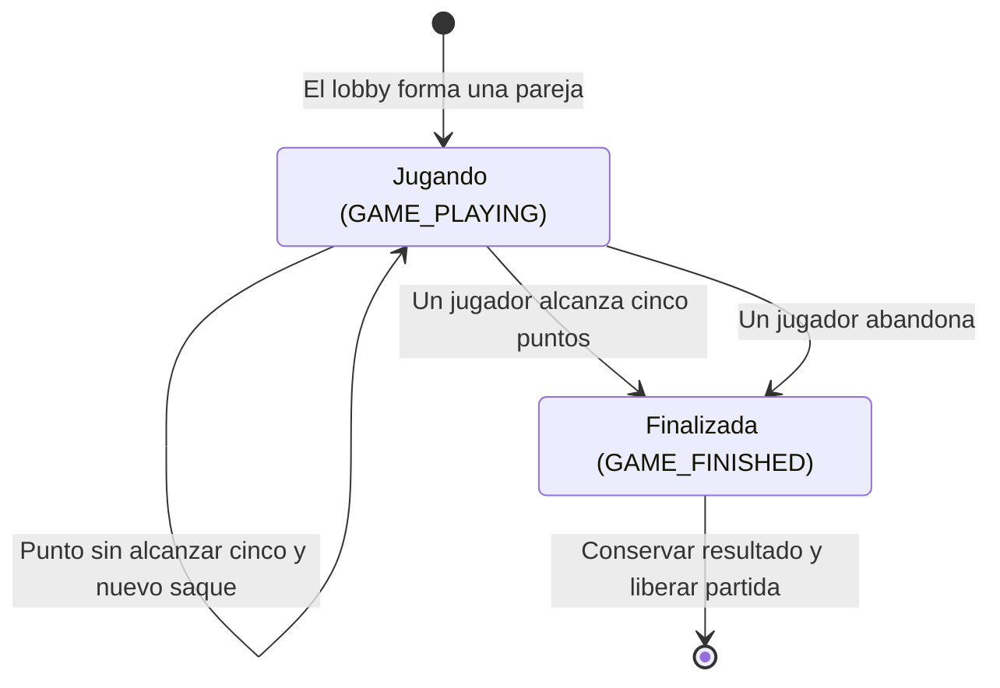
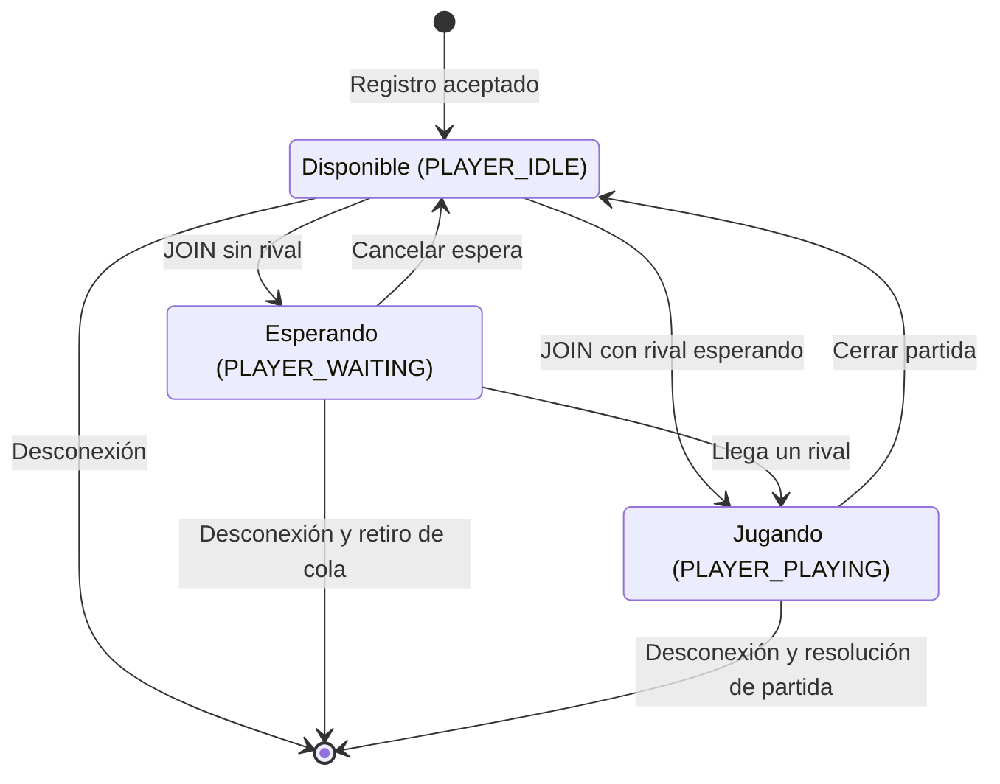

# Pong - Multiplayer Online Game

Internet: Arquitectura y Protocolos — EAFIT

### Integrantes
- leidy Gallo
- leidy Dayhana Roldan
- Miguel Mercado

### Ejecución rápida

Servidor (Linux, en AWS o local):

```bash
make -C server
./server/server 5000 pong.log
```

Cliente (en cada computador, requiere Python 3 y pygame):

```bash
pip3 install -r client/requirements.txt
python3 client/pong_client.py <IP_DEL_SERVIDOR> 5000 <nickname> <email>
```

Controles: flechas ↑ ↓ (o W/S) para mover la paleta, ESPACIO para jugar otra vez, ESC para salir. Los pasos completos de despliegue están en [Despliegue en AWS](#despliegue-en-aws).

## Introducción

El proyecto desarrolla un juego Pong multijugador con arquitectura cliente/servidor. El servidor está implementado en C con sockets Berkeley e hilos POSIX, y el cliente gráfico utiliza Python y pygame.

El servidor es responsable del estado de las partidas: valida las acciones, calcula movimientos y colisiones, mantiene el marcador y determina al ganador. El cliente envía intenciones de movimiento y representa el estado recibido.

La comunicación utiliza MyAppGameProtocol, un protocolo binario de capa de aplicación sobre TCP.

## Desarrollo

### Arquitectura

El sistema contempla varios clientes conectados a un servidor que administra jugadores, una cola de espera y partidas independientes entre parejas.

La implementación se organiza en los siguientes módulos:

| Archivo o módulo | Responsabilidad |
|---|---|
| `server/src/server.c` | Aceptar conexiones, atender los mensajes de cada cliente y enviar estados y resultados de las partidas. |
| `server/src/net.h` y `net.c` | Enviar y recibir mensajes completos sobre TCP. |
| `server/src/logger.h` y `logger.c` | Registrar eventos en consola y archivo. |
| `server/src/protocol.h` y `protocol.c` | Interpretar y construir los payloads binarios. |
| `server/src/game.h` y `game.c` | Estado, física, colisiones, puntuación, victoria y abandono. |
| `server/src/players.h` y `players.c` | Registro, consulta y eliminación de perfiles. |
| `server/src/lobby.h` y `lobby.c` | Espera, emparejamiento y limpieza de partidas. |
| `server/src/engine.h` y `engine.c` | Coordinar el acceso a los datos compartidos mediante un mutex. |
| `server/src/match_loop.h` y `match_loop.c` | Administrar el hilo de actualización de cada partida. |
| `client/protocol.py` | Implementar el protocolo binario en Python. |
| `client/pong_client.py` | Conexión, teclado y representación gráfica del juego. |
| `tests/bots.py` | Jugadores simulados para probar varias partidas simultáneas contra el servidor. |

#### Estado actual de integración

Los módulos de red, lógica y protocolo están integrados en el mismo ejecutable. El servidor atiende el ciclo completo de una partida: registro, cola de espera, emparejamiento, movimientos, envío del estado, fin por puntos y fin por abandono.

Se probó con el cliente pygame real y con jugadores simulados (`tests/bots.py`) jugando hasta 10 partidas al mismo tiempo. Los resultados están en la sección [Pruebas](#pruebas).

#### Hilos del servidor

El servidor usa dos tipos de hilos:

| Hilo | Cuántos hay | Qué hace |
|---|---|---|
| Hilo principal (`main`) | 1 | Espera conexiones con `accept` y crea un hilo por cliente. |
| Hilo de cliente (`client_thread`) | 1 por conexión | Lee los mensajes de su cliente y los atiende según el tipo. |
| Hilo de partida (`run_match` en `match_loop.c`) | 1 por partida | Avanza la física cada ~16 ms y envía `STATE` a los dos jugadores. |

Cuando el segundo jugador envía `JOIN`, su hilo de cliente envía `MATCH_START` a los dos y arranca el hilo de la partida. Ese hilo llama a `on_match_event` (en `server.c`) después de cada paso para enviar el estado. Cuando alguien llega a 5 puntos, el hilo libera la partida en el motor y luego envía `GAME_OVER`. Así los jugadores ya pueden enviar `JOIN` otra vez cuando reciben el resultado.

#### Cómo responde el servidor a cada mensaje

| Mensaje recibido | Condición | Respuesta |
|---|---|---|
| `REGISTER` | Datos válidos | `REGISTER_RESULT` con resultado OK y el id del jugador |
| `REGISTER` | Datos inválidos o conexión ya registrada | `REGISTER_RESULT` con el código del problema |
| `JOIN` | No hay nadie esperando | `WAITING` |
| `JOIN` | Hay un rival esperando | `MATCH_START` a los dos jugadores y luego `STATE` ~60 veces por segundo |
| `JOIN` | Sin registro / ya esperando o jugando | `ERROR` 2 / `ERROR` 3 |
| `MOVE` | En partida | Ninguna: el cambio se ve en el siguiente `STATE` |
| `MOVE` | Sin registro / sin partida / dirección inválida | `ERROR` 2 / `ERROR` 3 / `ERROR` 1 |
| `PING` | Siempre | Ninguna: solo evita el cierre por inactividad |
| `QUIT` o desconexión | Estaba jugando | El rival recibe `GAME_OVER` con motivo abandono |
| Tipo desconocido o payload mal formado | — | `ERROR` 1 |
| Versión o longitud de encabezado inválida | — | Se cierra la conexión |

#### Envíos desde varios hilos

Al socket de un jugador pueden escribir dos hilos: el suyo (respuestas como `WAITING`) y el de su partida (`STATE`). Si escribieran al mismo tiempo, los bytes de los dos mensajes podrían mezclarse. Por eso cada cliente tiene un mutex `send_lock` y todos los envíos pasan por `send_to_client`.

Para enviar a otro jugador se usa `send_to_player(id, ...)`, que busca al cliente en la lista mientras tiene el mutex `clients_lock`. Así el cliente no puede borrarse mientras se le está enviando. Cada socket tiene un tiempo límite de envío de 2 segundos (`SO_SNDTIMEO`) para que un cliente que no lee no bloquee al servidor.

Al desconectarse, el cliente primero se retira de la lista y después se resuelve su partida. De esta forma el hilo de la partida ya no le envía nada y el rival recibe un solo `GAME_OVER`.

### Protocolo: MyAppGameProtocol

#### Especificación del servicio

El protocolo define los siguientes servicios:

1. Registro de jugadores con nickname y correo electrónico.
2. Entrada al lobby y emparejamiento.
3. Envío de intenciones de movimiento.
4. Notificación del estado de la partida.
5. Notificación del resultado y solicitud de una nueva partida.
6. Mantenimiento de la conexión mediante mensajes de actividad.

El cliente no determina posiciones ni puntos. Las acciones recibidas deben validarse y aplicarse en el servidor.

#### Transporte: TCP

Se utiliza TCP (`SOCK_STREAM`) para todos los mensajes.

TCP proporciona un flujo de bytes ordenado y mecanismos de retransmisión. Esto simplifica la comunicación de registros, acciones y resultados, aunque no garantiza la entrega si la conexión falla.

Para este proyecto se prioriza la simplicidad de mantener una sola conexión por cliente. El costo de esta elección es que una pérdida de paquetes puede retrasar mensajes posteriores mientras TCP recupera los datos.

TCP no conserva fronteras entre mensajes. Por eso cada mensaje incluye una longitud y las funciones de recepción repiten la lectura hasta completar los bytes requeridos.

Un cierre ordenado del otro extremo puede detectarse cuando `recv` devuelve cero. Otras fallas pueden requerir un error o un timeout para detectarse.

#### Formato del mensaje

Cada mensaje contiene un encabezado fijo de cuatro bytes seguido del payload.

| Posición | Campo | Tamaño |
|---|---|---|
| 0 | Versión | 1 byte |
| 1 | Tipo | 1 byte |
| 2–3 | Longitud del payload | 2 bytes |
| 4 en adelante | Payload | De 0 a 512 bytes |

La versión actual es `1`. Los enteros de varios bytes se codifican en orden de red, big-endian.

Los textos se codifican en UTF-8 y se preceden por un byte que indica su longitud en bytes. No incluyen el terminador `'\0'` de C dentro del mensaje.

El tamaño máximo del payload es 512 bytes.

#### Mensajes del cliente al servidor

| Tipo | Nombre | Payload | Función |
|---|---|---|---|
| `0x01` | `REGISTER` | Longitud de nickname: 1B; nickname; longitud de correo: 1B; correo | Solicitar registro. |
| `0x02` | `JOIN` | Sin payload | Solicitar entrada al lobby. |
| `0x03` | `MOVE` | Dirección: 1B | Cambiar la intención de movimiento. |
| `0x04` | `PING` | Sin payload | Mantener activa la conexión. |
| `0x05` | `QUIT` | Sin payload | Solicitar salida y cerrar la conexión. |

En `MOVE`, los valores de la red son:

| Valor | Acción |
|---|---|
| `0` | Quieto |
| `1` | Arriba |
| `2` | Abajo |

`proto_parse_move` convierte estos códigos a los valores internos `MOVE_STOP`, `MOVE_UP` y `MOVE_DOWN`.

#### Mensajes del servidor al cliente

| Tipo | Nombre | Payload |
|---|---|---|
| `0x81` | `REGISTER_RESULT` | Resultado: 1B; ID de jugador: 4B |
| `0x82` | `WAITING` | Sin payload |
| `0x83` | `MATCH_START` | ID de partida: 4B; lado: 1B; longitud de nickname rival: 1B; nickname rival |
| `0x84` | `STATE` | Pelota x: 2B; pelota y: 2B; paleta izquierda y: 2B; paleta derecha y: 2B; puntos izquierda: 1B; puntos derecha: 1B |
| `0x85` | `GAME_OVER` | ID ganador: 4B; puntos izquierda: 1B; puntos derecha: 1B; motivo: 1B |
| `0x86` | `ERROR` | Código de error: 1B |

`STATE` contiene diez bytes de payload y catorce bytes incluyendo el encabezado. Las posiciones se transmiten como enteros; el servidor conserva su representación interna con decimales.

Resultados de registro:

| Valor | Significado |
|---|---|
| `0` | Registro aceptado |
| `1` | Datos inválidos |
| `2` | Conexión ya registrada |
| `3` | Registro lleno |

Si el registro falla, el ID enviado es cero.

En `MATCH_START`, el lado `0` es izquierda y el lado `1` es derecha.

Motivos de finalización:

| Valor | Significado |
|---|---|
| `0` | Victoria por puntuación |
| `1` | Victoria por abandono |

Códigos de `ERROR`:

| Valor | Significado |
|---|---|
| `1` | Mensaje mal formado o tipo desconocido |
| `2` | Jugador no registrado |
| `3` | Acción inválida para el estado actual |
| `4` | Sin capacidad disponible |

#### Ejemplo de registro

El registro de `Ana` con correo `ana@x.co` ocupa 17 bytes: cuatro de encabezado y trece de payload.

```text
01 01 00 0D 03 41 6E 61 08 61 6E 61 40 78 2E 63 6F
```

El payload contiene la longitud `3`, el texto `Ana`, la longitud `8` y el texto `ana@x.co`.

#### Reglas de procedimiento

El siguiente comportamiento define el intercambio que debe completar la integración:

1. El cliente conecta y envía `REGISTER`.
2. El servidor responde `REGISTER_RESULT`.
3. Si el registro es aceptado, el cliente envía `JOIN`.
4. Si no hay rival, recibe `WAITING`.
5. Cuando se forma una pareja, ambos reciben `MATCH_START`.
6. Durante la partida, el cliente envía `MOVE` cuando cambia su intención.
7. El servidor actualiza la partida y envía `STATE` periódicamente.
8. Al terminar, envía `GAME_OVER`. Los jugadores conectados pueden solicitar otra partida con `JOIN`.
9. El cliente envía `PING` tras diez segundos sin enviar otros mensajes. No espera una respuesta.
10. `QUIT` o una desconexión requieren limpiar los datos del jugador.

El servidor configura un timeout de recepción de 30 segundos. No constituye un plazo estricto para completar todo un mensaje: la recepción puede requerir varias llamadas a `recv`.

`JOIN` o `MOVE` antes del registro deben producir `ERROR 2`. Un movimiento fuera de partida debe producir `ERROR 3`. Los payloads mal formados y tipos desconocidos deben producir `ERROR 1`.

La implementación de recepción rechaza encabezados con una versión distinta de `1` o longitud superior a 512 y cierra la conexión.

#### Diagrama de secuencia

Este diagrama representa el intercambio previsto entre clientes y servidor.



#### Implementación del protocolo

El encabezado se construye y recibe mediante `send_message` y `recv_message` de `net.c`.

Las funciones de `protocol.c` procesan el payload:

| Función | Uso |
|---|---|
| `proto_parse_register` | Extraer nickname y correo como cadenas terminadas en cero. |
| `proto_parse_move` | Validar y convertir la dirección de movimiento. |
| `proto_build_register_result` | Construir la respuesta de registro. |
| `proto_build_match_start` | Construir la notificación de inicio. |
| `proto_build_state` | Codificar posiciones y marcador. |
| `proto_build_game_over` | Codificar ganador, marcador y motivo. |
| `proto_build_error` | Construir una respuesta de error. |
| `proto_type_name` | Obtener el nombre del mensaje para el logger. |

La validación de estructura binaria pertenece al protocolo. La validación del contenido y del estado del jugador pertenece a la lógica del servidor.

### Servidor

#### Reglas y coordenadas

La cancha utiliza coordenadas lógicas con origen `(0, 0)` en la esquina superior izquierda. El eje `x` aumenta hacia la derecha y el eje `y` hacia abajo.

| Parámetro | Valor |
|---|---|
| Cancha | 800 × 600 unidades |
| Paletas | 20 × 100 unidades |
| Separación del borde lateral | 30 unidades |
| Posición horizontal izquierda | 30 |
| Posición horizontal derecha | 750 |
| Radio de la pelota | 10 unidades |
| Velocidad de paletas | 300 unidades por segundo |
| Velocidad inicial horizontal de pelota | 300 unidades por segundo |
| Velocidad inicial vertical de pelota | 150 unidades por segundo |
| Victoria | 5 puntos |

La posición de una paleta corresponde a su esquina superior izquierda. Su coordenada vertical se limita a `[0, 500]`.

La posición de la pelota corresponde a su centro. Rebota contra el techo y el piso considerando su radio.

Los choques contra las caras interiores de las paletas utilizan una aproximación rectangular de la pelota. No se calcula una colisión circular exacta en las esquinas.

Cuando la pelota sale completamente por un extremo lateral, marca el jugador contrario. Si nadie ha ganado, la pelota vuelve al centro y sale hacia quien recibió el punto. Las paletas conservan sus posiciones.

Al alcanzar cinco puntos, se guarda el ganador, se cambia el estado a finalizada y se detiene la pelota. Si alguien abandona durante una partida activa, gana su rival y se conserva el marcador.

#### Registro de jugadores

El registro asocia cada perfil con el ID de conexión asignado por el servidor.

Los límites son 32 bytes para nickname y 128 para correo, sin contar el terminador de cadena de C.

Se rechazan identificadores no positivos, textos vacíos, tamaños superiores al límite, espacios y caracteres de control.

El correo debe contener una sola arroba y texto a ambos lados. Es una validación básica: no comprueba que la cuenta exista.

Una conexión no puede registrar dos perfiles. Actualmente se permiten nicknames y correos repetidos entre conexiones diferentes.

Las funciones de registro reciben cadenas válidas de C terminadas en cero. El protocolo convierte los textos recibidos a esa representación antes de entregarlos a la lógica.

#### Lobby y emparejamiento

El registro admite hasta 64 jugadores. El lobby dispone de 32 espacios de partidas.

Los estados del jugador son:

- `PLAYER_IDLE`: registrado y disponible.
- `PLAYER_WAITING`: esperando rival.
- `PLAYER_PLAYING`: asociado a una partida.

El primer jugador espera. Al llegar otro disponible se forma una pareja: el primero controla la paleta izquierda y el segundo la derecha.

No se permite entrar nuevamente al lobby mientras se espera o juega. Cancelar la espera conserva el perfil y deja al jugador disponible.

Al cerrar una partida, se conserva una copia del resultado y se libera su espacio. Los jugadores conectados quedan disponibles para otro `JOIN`.

Una desconexión retira al jugador de la cola o resuelve su partida y elimina su perfil.

#### Entradas y ciclo de juego

El motor guarda la última intención de movimiento de cada jugador. Recibir mensajes repetidos no desplaza inmediatamente la paleta.

El ciclo aplica esas direcciones según el tiempo de simulación. El cliente debe enviar `MOVE_STOP` al soltar la tecla.

Cada partida puede tener un hilo de actualización. Se rechaza iniciar dos ciclos activos para la misma partida.

El hilo espera aproximadamente 16 milisegundos entre actualizaciones y mide el tiempo transcurrido con `CLOCK_MONOTONIC`. La frecuencia no es exacta: depende de la planificación del sistema operativo.

Si el intervalo supera 0,25 segundos, se limita el avance a ese valor. La física divide cada actualización en pasos de hasta 0,005 segundos.

#### Sincronización

El motor utiliza un mutex compartido para coordinar el registro, el lobby, las entradas, las consultas, las actualizaciones y la limpieza.

Las consultas entregan copias del estado. Los consumidores no deben conservar punteros a espacios internos reutilizables.

Todos los accesos concurrentes deben respetar las funciones del motor y su bloqueo. El mutex no protege accesos directos que ignoren esta regla.

Las esperas se realizan fuera del bloqueo. Los envíos de red también se realizan fuera del mutex del motor: primero se obtiene una copia del estado y después se envía.

Los hilos buscan su partida por ID. Si se elimina y el espacio se reutiliza con otro ID, el hilo antiguo no actualiza la nueva partida.

#### Diagrama de estados de una partida

La espera pertenece al lobby. Cuando se forma la pareja, `game_create` crea la partida directamente en `GAME_PLAYING`.



El tipo de estados incluye `GAME_WAITING`, pero actualmente la espera se representa con `PLAYER_WAITING` en el lobby.

Detener el hilo mediante `match_loop_stop` no finaliza por sí solo la partida: detiene sus actualizaciones y recoge el hilo.

En el cierre normal por puntuación se recoge el hilo antes de liberar la partida. En una desconexión, el motor puede retirarla bajo el mutex; el hilo asociado debe recogerse igualmente.

El motor y las variables de control deben permanecer válidos mientras los hilos los utilicen. El motor se destruye después de recoger todos sus hilos.

El servidor no usa `match_loop_start`/`match_loop_stop` directamente, sino `match_loop_run_detached`. Esta función crea el hilo de la partida como independiente (`pthread_detach`): nadie lo espera con `join`. Cuando la partida termina por puntos, el mismo hilo la libera con `engine_finish_match`, avisa el resultado con `on_match_event` y borra su propia memoria. Si la partida terminó por una desconexión, `engine_disconnect` ya la liberó, `engine_finish_match` falla y el hilo termina sin enviar un segundo `GAME_OVER`.

#### Estados del jugador



La cancelación de espera existe en el módulo de lobby, pero el protocolo actual no define un mensaje específico para solicitarla conservando la conexión. `QUIT` implica salir.

#### Compilación y ejecución

Se requiere un entorno Linux con GCC, Make y soporte POSIX Threads. En Windows puede utilizarse WSL.

Desde la raíz del repositorio:

```bash
make -C server
```

Para ejecutar el servidor:

```bash
./server/server 5000 pong.log
```

Los argumentos son el puerto y la ruta del archivo de log. Ejecutándolo desde la carpeta `server`, el formato equivalente es:

```bash
./server 5000 pong.log
```

El logger escribe cada evento en consola y en el archivo de log, con fecha y hora:

- Conexiones, desconexiones y timeouts.
- Cada mensaje recibido (`RECV`), incluidos todos los `MOVE` con su dirección y los `PING`.
- Cada respuesta enviada (`SEND`): `REGISTER_RESULT`, `WAITING`, `MATCH_START`, `ERROR` y `GAME_OVER`.
- Registros de jugadores, inicio de partidas, cada punto anotado y el resultado final.
- El estado de cada partida (`STATE`): el servidor lo envía unas 60 veces por segundo a cada jugador; en el log se registra un resumen por segundo con la posición de la bola, las paletas y el marcador, para que el archivo se pueda leer.

Ejemplo:

```text
[2026-10-21 18:23:01] [INFO] Partida #1 iniciada: "bot1" (#1) vs "bot2" (#2)
[2026-10-21 18:23:01] [RECV] Cliente #2 -> MOVE abajo
[2026-10-21 18:23:02] [SEND] Partida #1 -> STATE a #1 y #2: bola=(696,448) paletas=(250,386) marcador 0-0
[2026-10-21 18:23:16] [INFO] Partida #1: punto, marcador 1-0
[2026-10-21 18:24:15] [SEND] Cliente #1 <- GAME_OVER len=7
[2026-10-21 18:24:15] [INFO] Partida #1 terminada 5-3, ganador jugador #1 (por puntos)
```

#### Pruebas

Desde la raíz:

```bash
make -C server test
```

| Prueba | Comportamientos comprobados |
|---|---|
| `test_game` | Movimientos, límites, rebotes, puntos, victoria y abandono. |
| `test_players` | Registro, consulta, validaciones, duplicidad por conexión y capacidad. |
| `test_lobby` | Emparejamiento, cancelación, cierre, reutilización y desconexiones. |
| `test_engine` | Registro y emparejamiento desde varios hilos; consultas, entradas y limpieza del motor. |
| `test_match_loop` | Movimiento automático, rechazo de ciclos duplicados, parada, desconexión, reutilización y victoria por puntos. |
| `test_protocol` | Codificación y lectura de payloads binarios y rechazo de mensajes inválidos. |

Para ejecutar las pruebas de protocolo en Python:

```bash
python3 -m unittest discover -s client -p test_protocol.py -v
```

Las pruebas en C y Python incluyen ejemplos con los mismos bytes esperados para comprobar compatibilidad.

#### Pruebas de red con jugadores simulados

`tests/bots.py` crea jugadores falsos que usan el mismo protocolo del cliente (`client/protocol.py`). Cada bot se registra, pide partida, sigue la bola con su paleta y juega hasta recibir `GAME_OVER`. Para que las partidas terminen, cada bot decide al azar (70 %) si defiende cada bola.

Con el servidor corriendo:

```bash
python3 tests/bots.py localhost 5000 5          # 5 partidas simultáneas
python3 tests/bots.py localhost 5000 3 --quit   # en cada pareja un jugador abandona
```

Resultados obtenidos:

| Prueba | Resultado |
|---|---|
| 3 partidas simultáneas hasta 5 puntos | 6/6 bots OK, ambos jugadores reciben el mismo `GAME_OVER` |
| 10 partidas simultáneas (20 jugadores) | 20/20 bots OK en 94 s, sin errores en el log |
| Abandono a mitad de partida | El rival recibe `GAME_OVER` con motivo abandono |
| Mensajes fuera de orden o mal formados | `ERROR` con el código correcto; versión inválida cierra la conexión |
| `JOIN` después de terminar (por puntos o por abandono) | `WAITING`: el jugador puede volver a jugar |
| Cliente pygame contra el servidor real | Registro, espera, partida y pantalla final correctos |
| Servidor compilado con ThreadSanitizer (`-fsanitize=thread`) | Sin condiciones de carrera detectadas |

ThreadSanitizer detectó al principio que `localtime` no es seguro con varios hilos. Se cambió por `localtime_r` en el logger.

Estas pruebas no garantizan ausencia de errores en todas las combinaciones posibles, pero cubren los flujos principales del juego con varias partidas a la vez.

Para limpiar archivos generados:

```bash
make -C server clean
```

### Cliente

El cliente está implementado en Python 3 con pygame. Recibe estados del servidor y los dibuja; no calcula la física.

#### Instalación y uso

Desde la raíz del repositorio:

```bash
cd client
python3 -m venv .venv
source .venv/bin/activate
python3 -m pip install -r requirements.txt
python3 pong_client.py <IP_SERVIDOR> <PUERTO> <nickname> <email>
```

En PowerShell de Windows, la activación del entorno es:

```powershell
.\.venv\Scripts\Activate.ps1
```

En Windows puede utilizarse `python` en lugar de `python3`, según la instalación.

#### Controles

| Tecla | Acción |
|---|---|
| Flecha arriba o W | Subir |
| Flecha abajo o S | Bajar |
| Espacio | Solicitar otra partida al terminar |
| Escape | Salir |

La paleta propia se representa en azul.

#### Funcionamiento

Un hilo recibe mensajes y los coloca en una cola. El ciclo principal de pygame procesa la cola, lee las teclas y dibuja la pantalla.

El cliente envía `MOVE` cuando cambia la intención de movimiento. Envía `PING` si transcurren diez segundos sin otros envíos.

Sus pantallas representan conexión, espera, partida, resultado y conexión cerrada.

#### Servidor de práctica

`client/fake_server.py` permite probar el cliente con el protocolo esperado. Es una herramienta de desarrollo y no reemplaza al servidor obligatorio en C.

Desde `client`, ejecutar en terminales separadas:

```bash
python3 fake_server.py 5000
```

```bash
python3 pong_client.py 127.0.0.1 5000 Ana ana@correo.com
```

```bash
python3 pong_client.py 127.0.0.1 5000 Bob bob@correo.com
```

### Despliegue en AWS

El servidor se despliega en una instancia EC2 de AWS Academy. Solo el servidor va a AWS; cada jugador ejecuta el cliente en su propio computador.

#### 1. Crear la instancia

En AWS Academy: *Start Lab* → *AWS* → *EC2* → *Launch instance*.

- **AMI:** Ubuntu Server 24.04 LTS.
- **Tipo:** `t2.micro` (o `t3.micro`).
- **Key pair:** crear uno nuevo y descargar el archivo `.pem`.
- **Security group:** permitir SSH (puerto 22) y agregar una regla *Custom TCP* para el puerto del juego (`5000`) con origen `0.0.0.0/0`.

#### 2. Conectarse e instalar

```bash
chmod 400 pong-key.pem
ssh -i pong-key.pem ubuntu@<IP_PUBLICA>

sudo apt update && sudo apt install -y build-essential git
git clone https://github.com/mimercadan/Pong-Project.git
cd Pong-Project
make -C server
make -C server test
```

Como el repositorio es privado, `git clone` pide usuario de GitHub y un *personal access token* en lugar de la contraseña.

#### 3. Ejecutar el servidor

```bash
./server/server 5000 pong.log
```

Para que siga corriendo al cerrar la sesión SSH:

```bash
nohup ./server/server 5000 pong.log > /dev/null 2>&1 &
tail -f pong.log        # ver el log en vivo
pkill -f "server/server" # detener el servidor
```

#### 4. Conectar los clientes

Desde cada computador:

```bash
python3 client/pong_client.py <IP_PUBLICA> 5000 Ana ana@correo.com
```

También se puede probar el servidor remoto con varias parejas simuladas:

```bash
python3 tests/bots.py <IP_PUBLICA> 5000 5
```

#### Validación del despliegue

El servidor se desplegó en una instancia EC2 `t3.micro` con Ubuntu Server 26.04 en AWS Academy (región us-east-1), con el puerto 5000 abierto en el *security group*. Desde computadores externos se probaron los bots y el cliente pygame contra la IP pública de la instancia, con partidas completas funcionando correctamente.

#### Notas

- La IP pública cambia cada vez que se reinicia el laboratorio de AWS Academy; hay que usar la que aparece en la consola de EC2.
- Si los clientes no se conectan, revisar primero la regla del puerto 5000 en el *security group*.
- No deben publicarse claves privadas (`.pem`), contraseñas ni credenciales de AWS.

## Conclusiones

Separar el sistema en módulos (red, protocolo, reglas del juego, jugadores, lobby y motor) permitió que cada parte se desarrollara y probara por separado antes de unirlas. Las pruebas unitarias de la lógica y del protocolo detectaron errores antes de la integración, y las pruebas compartidas de bytes entre C y Python aseguraron que cliente y servidor hablaran el mismo idioma.

Tener al servidor como única autoridad del juego simplifica la consistencia: los clientes solo envían intenciones (`MOVE`) y dibujan el estado que reciben, por lo que ninguno puede hacer trampa ni quedar desincronizado.

Usar solo TCP hizo más sencilla la implementación, porque los mensajes llegan completos y en orden. El costo es que TCP no conserva los límites de los mensajes; se resolvió con un encabezado de longitud fija y funciones que leen hasta completar cada mensaje.

La parte más delicada fue la concurrencia. Con un hilo por cliente y otro por partida, varios hilos acceden a los mismos datos y escriben en los mismos sockets. Se resolvió con un mutex en el motor, un mutex de envío por cliente y la regla de no enviar por la red mientras se tiene el mutex del motor. Las pruebas con varias partidas simultáneas y ThreadSanitizer ayudaron a confirmar el diseño e incluso encontraron un error en el logger (`localtime` en lugar de `localtime_r`).

## Referencias

- Enunciado del proyecto Pong — Internet: Arquitectura y Protocolos, EAFIT.
- Beej’s Guide to C Programming: https://beej.us/guide/bgc/
- Beej’s Guide to Network Programming: https://beej.us/guide/bgnet/
- GeeksforGeeks, TCP Server-Client implementation in C: https://www.geeksforgeeks.org/tcp-server-client-implementation-in-c/
- POSIX Threads (`pthreads`): https://man7.org/linux/man-pages/man7/pthreads.7.html
- ThreadSanitizer: https://clang.llvm.org/docs/ThreadSanitizer.html
- Documentación de pygame: https://www.pygame.org/docs/
- AWS, Amazon EC2 User Guide: https://docs.aws.amazon.com/ec2/
- Documentación de Python: https://docs.python.org/3/
