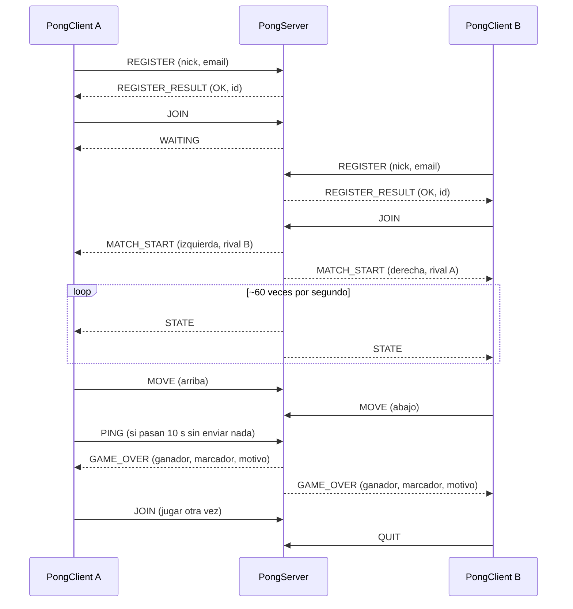

# Pong - Multiplayer Online Game
Internet: Arquitectura y Protocolos - EAFIT

## Introducción

## Desarrollo
### Arquitectura
### Protocolo (MyAppGameProtocol)

MyAppGameProtocol es un protocolo de capa de aplicación, **binario**, que permite que el PongClient se registre, busque rival, envíe sus movimientos y reciba el estado de la partida que calcula el PongServer.

#### Especificación del servicio

El protocolo ofrece al cliente cuatro servicios:

1. **Registro**: crear un perfil con nickname y correo electrónico.
2. **Emparejamiento**: entrar a la cola del lobby y ser emparejado con otro jugador.
3. **Juego**: enviar la intención de movimiento de la paleta y recibir el estado del juego unas 60 veces por segundo.
4. **Fin de partida**: recibir el resultado (por puntaje o por abandono del rival) y poder volver a jugar.

El servidor es la única autoridad sobre el estado del juego: el cliente no envía posiciones, solo intenciones (subir, bajar, quieto), y el servidor valida y calcula todo lo demás. Así un cliente modificado no puede, por ejemplo, teletransportar su paleta.

#### Transporte: TCP

Se usa **TCP (`SOCK_STREAM`)** para todos los mensajes:

- El registro, el emparejamiento y el fin de partida **no se pueden perder**; TCP garantiza la entrega y el orden sin que el protocolo tenga que implementar confirmaciones ni retransmisiones.
- Los mensajes de estado son pequeños (14 bytes con encabezado) y viajan en una red con poca pérdida, así que el costo de TCP es bajo para un juego como Pong.
- Usar una sola conexión simplifica el servidor: cada cliente tiene un hilo y un socket, y la desconexión de un jugador se detecta de inmediato (`recv` devuelve 0), lo que permite declarar el abandono.

Como TCP es un flujo de bytes sin fronteras, cada mensaje lleva su longitud en el encabezado para que el receptor sepa dónde termina (ver `recv_all` en `net.c` y `protocol.py`).

#### Formato del mensaje

Todo mensaje es un encabezado fijo de 4 bytes seguido del payload. Todos los números van en **orden de red (big-endian)** y los textos en UTF-8, precedidos por un byte con su longitud (sin `\0` final).

```
 0        1        2        3        4 ...
+--------+--------+--------+--------+------------------------+
| versión|  tipo  |    longitud     |  payload (0..512 bytes) |
|  (=1)  |        |  del payload    |                         |
+--------+--------+--------+--------+------------------------+
```

| Campo | Tamaño | Descripción |
|---|---|---|
| versión | 1 byte | Siempre `1`. Si llega otra, el receptor cierra la conexión. |
| tipo | 1 byte | Tipo de mensaje. `0x01–0x7F`: cliente → servidor. `0x81–0xFF`: servidor → cliente. |
| longitud | 2 bytes | Bytes del payload (máximo 512). |

#### Vocabulario de mensajes

**Cliente → servidor**

| Tipo | Nombre | Payload | Descripción |
|---|---|---|---|
| `0x01` | `REGISTER` | `nick_len` 1B · `nick` · `email_len` 1B · `email` | Crea el perfil. Nickname de 1 a 32 bytes y correo de 1 a 128. |
| `0x02` | `JOIN` | — | Pide entrar a la cola para jugar. |
| `0x03` | `MOVE` | `dirección` 1B | `0` quieto, `1` arriba, `2` abajo. Se envía cuando cambia la tecla presionada. |
| `0x04` | `PING` | — | "Sigo aquí". El servidor no responde; solo reinicia el plazo de inactividad. |
| `0x05` | `QUIT` | — | El cliente se retira y cierra la conexión. |

**Servidor → cliente**

| Tipo | Nombre | Payload | Descripción |
|---|---|---|---|
| `0x81` | `REGISTER_RESULT` | `resultado` 1B · `player_id` 4B | `0` OK, `1` datos inválidos, `2` ya registrado, `3` servidor lleno. Si no es OK, `player_id = 0`. |
| `0x82` | `WAITING` | — | El jugador quedó en cola esperando rival. |
| `0x83` | `MATCH_START` | `match_id` 4B · `lado` 1B · `nick_len` 1B · `nick_rival` | Empieza la partida. `lado`: `0` izquierda, `1` derecha. |
| `0x84` | `STATE` | `ball_x` 2B · `ball_y` 2B · `paleta_izq_y` 2B · `paleta_der_y` 2B · `puntos_izq` 1B · `puntos_der` 1B | Estado de la partida, unas 60 veces por segundo. Posiciones en píxeles enteros sobre una cancha de 800×600 (pelota: centro; paletas: borde superior). |
| `0x85` | `GAME_OVER` | `winner_id` 4B · `puntos_izq` 1B · `puntos_der` 1B · `motivo` 1B | Fin de la partida. `motivo`: `0` alguien llegó a 5 puntos, `1` el rival abandonó. |
| `0x86` | `ERROR` | `código` 1B | `1` mensaje mal formado o tipo desconocido, `2` no registrado, `3` acción que no aplica en ese momento, `4` no hay cupo. |

Ejemplo: el registro de `Ana` con correo `ana@x.co` viaja así (17 bytes):

```
01 01 00 0D | 03 41 6E 61 | 08 61 6E 61 40 78 2E 63 6F
encabezado  | 3 "Ana"     | 8 "ana@x.co"
```

#### Reglas de procedimiento

1. El cliente abre la conexión TCP y envía `REGISTER`. El servidor responde `REGISTER_RESULT`.
2. Con el registro aceptado, el cliente envía `JOIN`. Si no hay rival disponible, el servidor responde `WAITING`; cuando lo hay, envía `MATCH_START` a los dos jugadores.
3. Durante la partida, el cliente envía `MOVE` cada vez que cambia su intención y el servidor envía `STATE` a ambos jugadores en cada ciclo de la simulación.
4. Cuando un jugador llega a 5 puntos, o uno de los dos se desconecta, el servidor envía `GAME_OVER` y los jugadores quedan libres para enviar `JOIN` de nuevo.
5. Si el servidor no recibe ningún mensaje en **30 segundos**, cierra la conexión. Por eso el cliente envía `PING` cada 10 segundos si no ha enviado nada más.
6. `JOIN` o `MOVE` antes de registrarse se responden con `ERROR 2`; un `MOVE` fuera de partida, con `ERROR 3`; un payload mal formado o un tipo desconocido, con `ERROR 1`.
7. Un encabezado con versión distinta de `1` o longitud mayor a 512 hace que el receptor cierre la conexión, porque ya no es posible saber dónde empieza el siguiente mensaje.
8. Si un jugador se desconecta en medio de una partida, el rival gana por abandono (`GAME_OVER` con motivo `1`).

#### Diagrama de secuencia



#### Implementación

El protocolo está implementado en los dos lenguajes, con pruebas que verifican **los mismos bytes** en ambos:

| Archivo | Uso |
|---|---|
| `server/src/protocol.h`, `protocol.c` | Funciones en C que usa el servidor: `proto_parse_register`, `proto_parse_move` para leer, y `proto_build_register_result`, `proto_build_match_start`, `proto_build_state`, `proto_build_game_over`, `proto_build_error` para armar. `proto_type_name` da el nombre del tipo para el logger. |
| `server/tests/test_protocol.c` | Pruebas en C (`make test`). |
| `client/protocol.py` | El mismo protocolo en Python, usado por el cliente. |
| `client/test_protocol.py` | Pruebas en Python (`python3 -m unittest test_protocol` desde `client/`). |

El encabezado lo envían y reciben `send_message`/`recv_message` de `net.c`; las funciones de `protocol.c` solo arman o leen el payload. Por ejemplo, para enviar el estado de una partida:

```c
uint8_t payload[MAX_PAYLOAD];
int len = proto_build_state(payload, &snapshot);
send_message(fd, MSG_STATE, payload, (uint16_t)len);
```

### Servidor
### Cliente

El PongClient está escrito en **Python 3 con pygame** (`client/pong_client.py`). No calcula la física del juego: envía las teclas del jugador y dibuja el estado que recibe del servidor.

**Instalación y uso**

```bash
cd client
pip install -r requirements.txt
python3 pong_client.py <IP_SERVIDOR> <PUERTO> <nickname> <email>
```

Controles: **flecha arriba / W** y **flecha abajo / S** para mover la paleta, **ESPACIO** para jugar otra vez al terminar y **ESC** para salir. La paleta propia se dibuja en azul.

**Funcionamiento**

- Un hilo lee los mensajes del socket y los deja en una cola; el ciclo principal de pygame (60 cuadros por segundo) los procesa, lee el teclado y dibuja. Así la ventana nunca se congela esperando datos de la red.
- `MOVE` se envía solo cuando cambia la tecla presionada, no en cada cuadro, para no saturar la red.
- Si pasan 10 segundos sin enviar nada (por ejemplo, esperando rival), el cliente envía `PING` para que el servidor no lo desconecte.
- Pantallas: *Conectando* → *Esperando rival* → *Partida* → *Resultado* (con opción de volver a jugar). Si la conexión se cierra, el cliente lo muestra en pantalla.
- En la consola se registran los mensajes enviados y recibidos (excepto `STATE`, por su frecuencia).

**Servidor de práctica**

`client/fake_server.py` es un servidor mínimo en Python que habla el mismo protocolo. Sirve para probar el cliente sin el PongServer y como referencia de las respuestas esperadas a cada mensaje. No reemplaza al servidor en C:

```bash
python3 fake_server.py 5000
python3 pong_client.py 127.0.0.1 5000 Ana ana@correo.com   # en otra terminal
python3 pong_client.py 127.0.0.1 5000 Bob bob@correo.com   # y en otra más
```

### Despliegue en AWS

## Conclusiones

## Referencias
